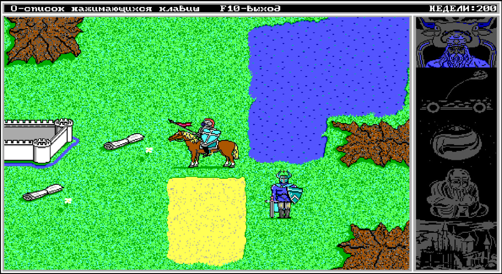

# King's Bounty 2 — continued



Продолжение DOS-игры на Turbo Pascal 7.0. Ветка `continued` предназначена для рефакторинга, исправления ошибок, развития баланса и нового контента. Историческая реконструкция сохранена в ветке [`main`](https://github.com/pavel-voronin/kb2-continued/tree/main).

Сборка остаётся DOS-приложением; [локальная веб-страница](WEB/README.md) запускает тот же EXE через эмулятор. Структурный рефакторинг завершён; игровые правила пока сохранены. Веб-страница переключает отдельные сборки Classic и Continued; исправления правил ещё впереди. [Известные и потенциальные ошибки](BUGS.md).

Оригинальную игру разработал **Сергей Прокофьев**.

## Собрать и запустить

Скопируйте папку проекта в DOS и выполните из её корня:

```dos
BUILD
RUN
```

Готовая игра появляется в `SRC/DIST/`.

На современном компьютере установите DOSBox-X отдельно. Откройте эмулятор и подключите папку проекта как диск:

```dos
MOUNT C C:\GAMES\KB2
C:
BUILD
RUN
```

Замените `C:\GAMES\KB2` на путь к своей копии проекта.

При публикации тега версии (`v1`, `v1.2`, `v1.2.3`, в том числе с суффиксом `-rc.1`) GitHub Actions собирает игру и прикладывает к релизу portable-ZIP для Windows x64. В нём есть официальный DOSBox-X, настройки, лицензии и `START.BAT` для запуска. Устанавливать эмулятор отдельно не нужно. Упаковка описана в [RELEASE/portable.ps1](RELEASE/portable.ps1); версия DOSBox-X и его контрольные суммы закреплены в [RELEASE/dosbox-x.json](RELEASE/dosbox-x.json).

Описание релиза берётся из `CHANGELOG.md`: тегу `v1.2.3` соответствует заголовок `## 1.2.3 — YYYY-MM-DD`. Используется текст до следующего заголовка `##`; внутри допустимы списки, абзацы и подзаголовки `###`. Для предварительной версии нужен раздел с тем же суффиксом, например `## 1.2.3-rc.1 — YYYY-MM-DD`. Отсутствующая, пустая или повторяющаяся секция останавливает процесс до скачивания эмулятора и сборки игры. В конце описания автоматически добавляется инструкция запуска; авторство, лицензии и ссылки на исходники эмулятора находятся в архиве. Сам CHANGELOG скрипт не изменяет.

## Детали

Начните с `SRC/KB2.PAS` и `SRC/KBAPP.PAS`. [Модульные тесты и покрытие](TEST/README.md) проверяют каждый модуль отдельно и фиксируют текущее поведение, включая ошибки. Проверки относятся только к continued; соответствие оригинальной игре не требуется.


PCX-экраны имеют размер **640×350**. Атласы состоят из кадров **96×60**, по четыре в строке; `FONT.PCX` содержит 240 знаков **8×8**. При редактировании сохраняйте размеры, 16-цветную палитру EGA и четыре битовые плоскости PCX.

DOS-тексты и Pascal-исходники сохраняйте в **CP866 с CRLF**; имена DOS-файлов соответствуют **DOS 8.3**. Современная документация и инструменты используют **UTF-8**.


Состояние разделено на `Game.Campaign`, `Game.Runtime` и `Game.World`; физический порядок полей сохраняет совместимость со старыми сохранениями и ассемблерными процедурами. Кандидаты на ошибки собираются отдельно в [BUGS.md](BUGS.md).

Оригинальные файлы игры взяты из [Internet Archive](https://archive.org/details/msdos_Kings_Bounty_2_1993).

## Лицензия

Автор оригинальной игры — Сергей Прокофьев. Реконструкция исходного кода выполнена Павлом Ворониным.

В той мере, в какой мне принадлежат права на результаты реконструкции и дополнения проекта, я предоставляю их по [лицензии MIT](LICENSE). Права на оригинальную игру и сторонние компоненты сохраняются за их правообладателями.
